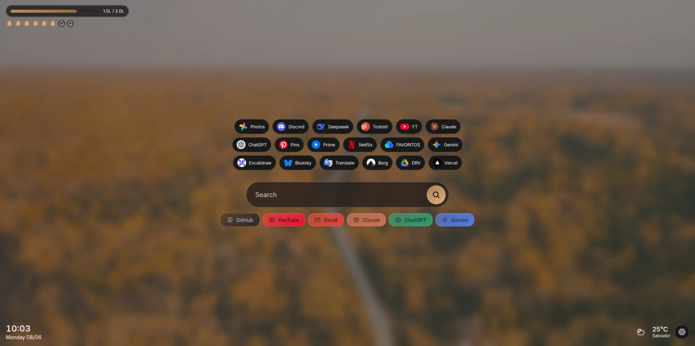
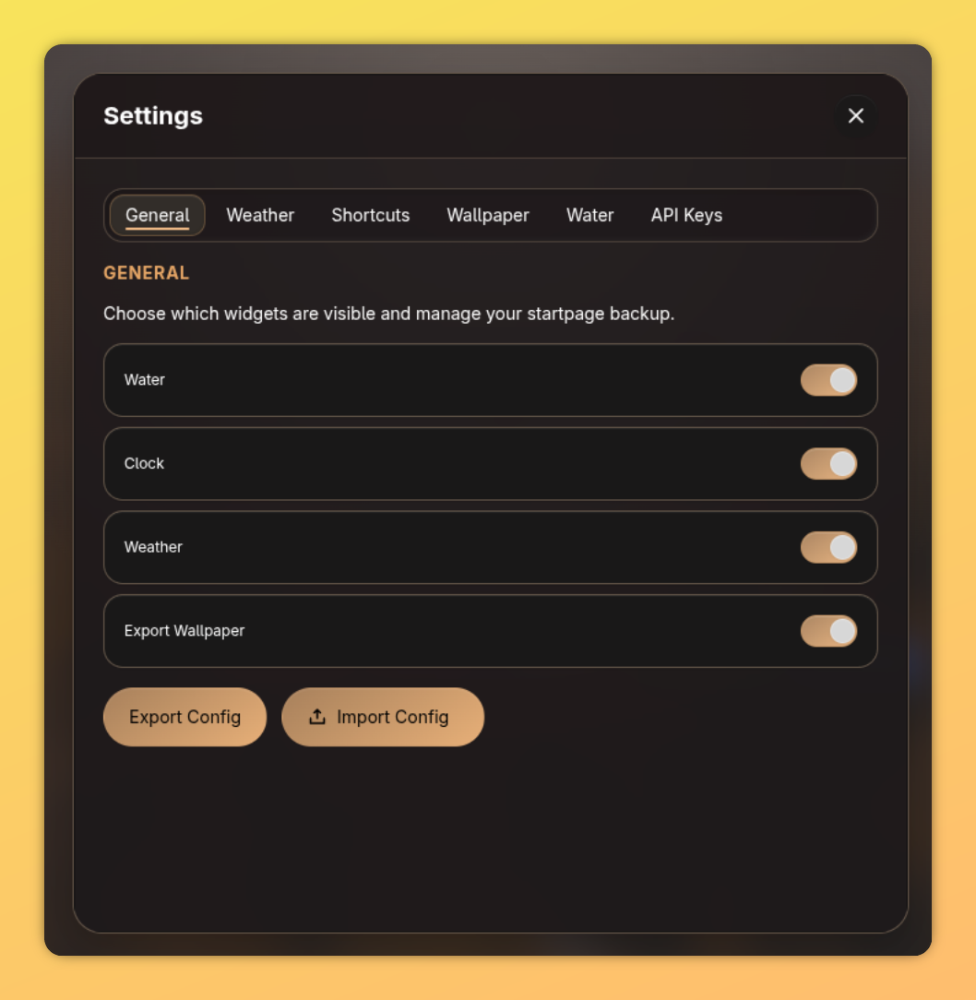

# A SIMPLE AND CLEAN STARTPAGE



## Requirements

- Google Chrome or another Chromium-based browser
- OpenWeather API keys (optional - required for weather widget)
- Wallpaper image (optional - required for customization)

## Installation

### From GitHub Releases

1. Download the latest release from the [releases page](https://github.com/devlulcas/personal-startpage-extension/releases)
2. Extract the zip file
3. Open Chrome and navigate to `chrome://extensions/`
4. Enable **Developer Mode** (toggle in top right)
5. Click **Load unpacked** and select the extracted folder

### Development

```bash
# Install dependencies
npm install

# Build the extension
npm run build

# Development mode with auto-rebuild
npm run dev
```

Then load the `dist` folder in Chrome:

1. Open `chrome://extensions/`
2. Enable "Developer mode"
3. Click "Load unpacked"
4. Select the `dist` folder

## Usage

Import a config file or config it from the ground up. It works fine without configs too:

